# Race gates for the MultiGP European Championship 2026

Design, documentation and build of the race gates for the 2nd MultiGP European Championship (11–13 September 2026, Aichtal, Germany).

<figure className="proj-fig">

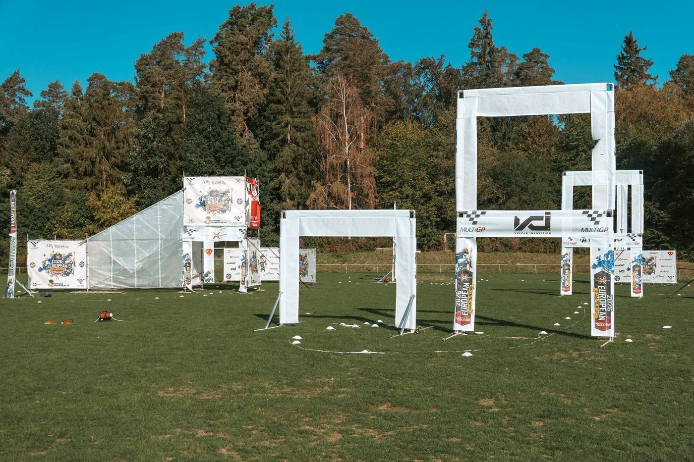

<figcaption>Single and double gates on the championship track (Photo: MultiGP)</figcaption>
</figure>

## Background

The 2nd MultiGP European Championship took place from 11 to 13 September 2026 at the SV07 Aich sports ground in Aichtal near Stuttgart. It was hosted by the chapters Aircrasher and Bavarian Multirotor, Europe's two largest MultiGP chapters. 104 pilots from around 21 countries took part. The total event budget was about EUR 23,000.

Race gates of this size at international events often bend heavily in wind and have to be held up with guy lines. For this championship a new set of gates was needed that is stable, can be assembled by volunteers and carries printed sponsor banners.

## Objective

Design and build a complete set of obstacles (4 double gates, 5 single gates and 10 flags) from aluminium tubing and standard tube connectors. The gates must stand without guy lines, be quick to assemble and dismantle, and fit printed fabric covers with sponsor logos.

## My role

I was a co-organiser of the event and part of the 7-person organising team. For the gates, my responsibilities were the design, the technical documentation, the specification of the fabric covers and the track build on site. I also set up regular team meetings so that everyone was aligned on tasks, timeline and status.

## Gate system and components

The gates are built as a modular tube-clamp system. The whole set uses only seven standard tube lengths, which keeps ordering, transport and assembly simple.

| Component | Use |
|---|---|
| Aluminium tubes, 7 lengths (0.5 m to 4.8 m) | Posts, crossbars, foot tubes and braces |
| Galvanised steel tube connectors (T-pieces, 90° elbows) | Fixed joints between posts, crossbars and foot tubes |
| Fixed 45° connectors (galvanised steel) | Diagonal braces between post and foot tube, corner braces on the double gate |
| Printed fabric covers with hem tunnels | Sponsor branding, slid over the tubes |

| Obstacle | Quantity | Main dimensions |
|---|---|---|
| Single gate | 5 | 2.9 m wide, 2.4 m posts, 2.9 m foot tubes |
| Double gate | 4 | Two gates stacked, 4.8 m posts, corner braces in the lower gate |
| Flag | 10 | 3.8 m pole on a braced T-base |

The key to stability is the foot: each post stands on a long foot tube and is supported by a 1 m diagonal brace. The brace is attached to the post and the foot tube with fixed 45° connectors, so the same parts fit every gate.

## CAD model

I modelled the gates in FreeCAD with the same connectors as the real build, including the fixed 45° connectors for the braces and the 90° elbows at the top corners, to check dimensions and part lists before ordering.

<figure className="proj-fig">

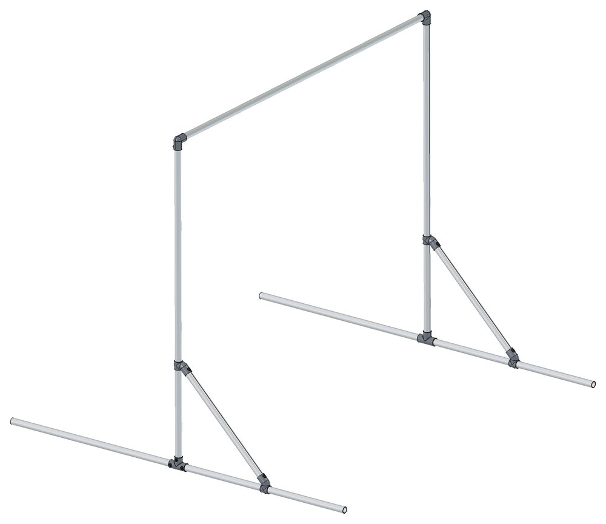

<figcaption>Single gate</figcaption>
</figure>
<figure className="proj-fig">

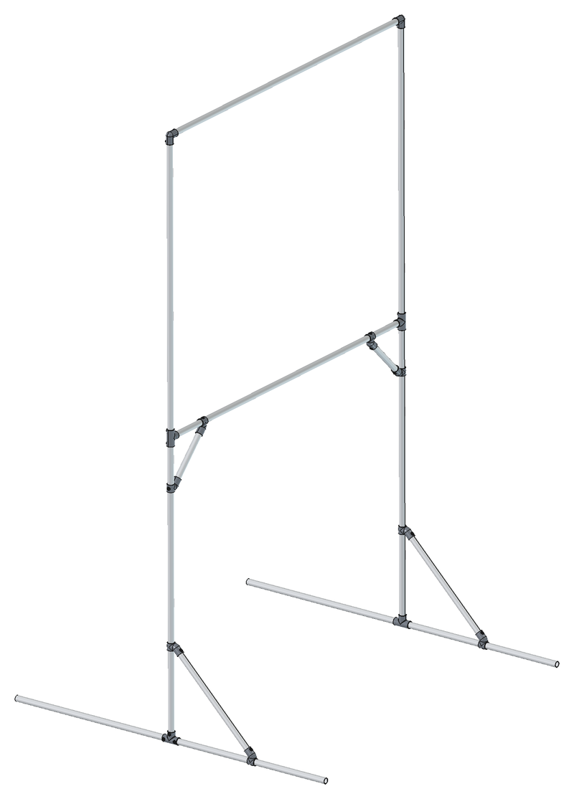

<figcaption>Double gate with corner braces</figcaption>
</figure>
<figure className="proj-fig">

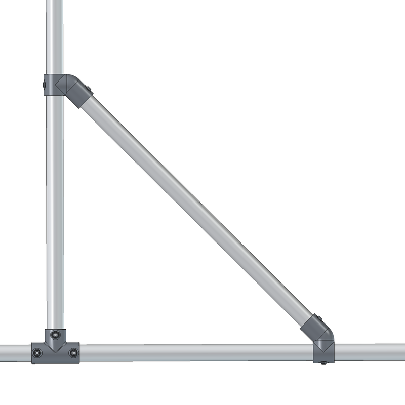

<figcaption>Foot brace with fixed 45° connectors</figcaption>
</figure>
<figure className="proj-fig">

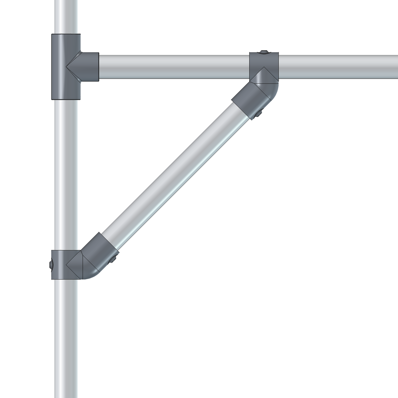

<figcaption>Corner brace of the double gate</figcaption>
</figure>

## Build guides and cutting guide

So that helpers could assemble the gates without me, I created two A4 build guides in draw.io. Every tube length has its own colour, and every joint shows a photo of the connector to use.

<figure className="proj-fig">

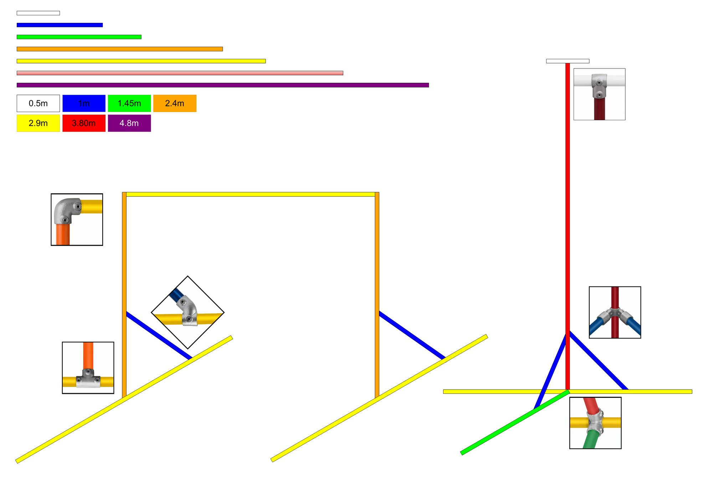

<figcaption>Build guide, front: single gate and flag</figcaption>
</figure>

<figure className="proj-fig">

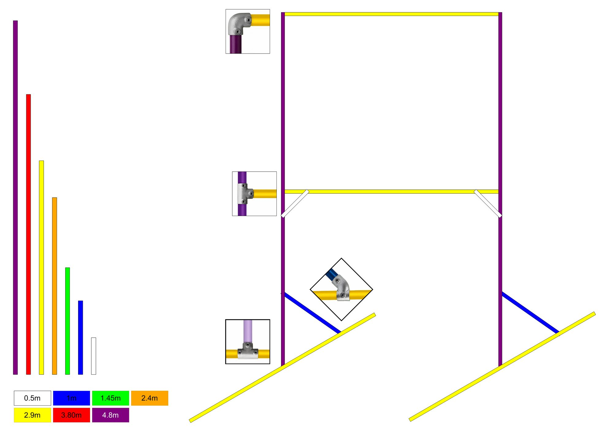

<figcaption>Build guide, back: double gate</figcaption>
</figure>

The fabric covers are slid over the tubes through sewn hem tunnels. Where a tube connector sits, the tunnel has to be opened. The cutting guide shows for each banner exactly where to cut it fully, where to open only the back of the hem, and which parts of the double gate are opened at the back.

<figure className="proj-fig">

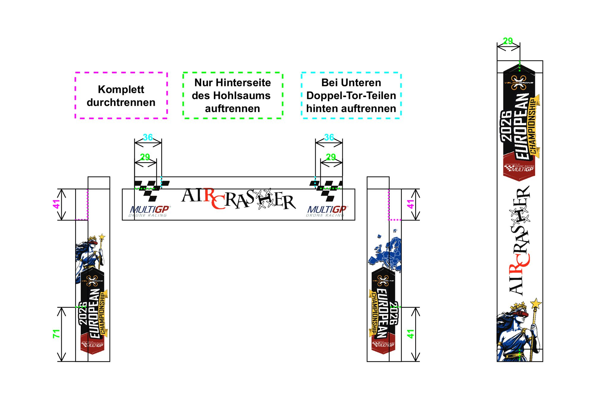

<figcaption>Cutting guide for the printed fabric covers (dimensions in cm)</figcaption>
</figure>

After the event, as a personal side project, I also rendered the gates with their fabric covers in Blender, using a cloth simulation with the real print designs and the openings from the cutting guide. These renders were not part of the planning.

<figure className="proj-fig proj-fig--narrow">

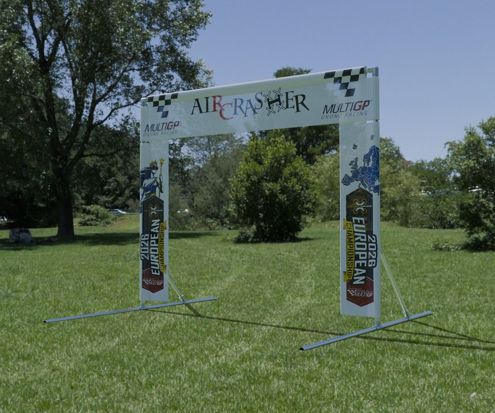

<figcaption>Single gate with fabric cover (Blender render, made after the event)</figcaption>
</figure>

## Fabric covers and supplier issue

I calculated the dimensions of all fabric covers, including the hem tunnels, from the tube diameters and the gate geometry. The covers were then ordered from a textile printer.

:::note[Supplier error]

The first delivery came out about 6 cm too small everywhere. The manufacturer's online instructions defined the hem tunnel as a diameter, but production treated the value as a flat measurement. I traced the error back to their documentation and proved that my calculation was correct. The supplier remade the covers, and the corrected fabric arrived only one week before the event.

:::

## Assembly and track build

The team assembled the gates using the build guides. I drew sketches for the larger scaffolding structures, which were built by a scaffolding contractor, and briefed the contractor on site. During the event setup I built the track and helped wherever needed.

<figure className="proj-fig">

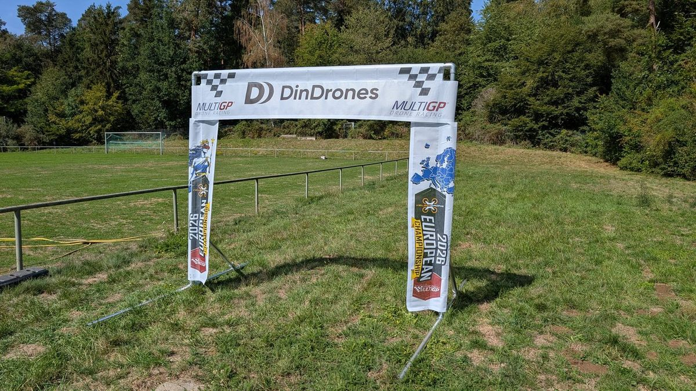

<figcaption>Single gate with fabric cover</figcaption>
</figure>
<figure className="proj-fig">

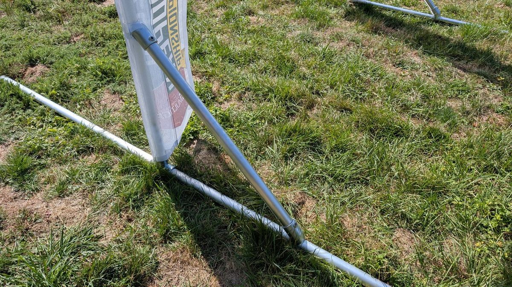

<figcaption>Foot with diagonal brace and 45° connectors</figcaption>
</figure>

<figure className="proj-fig">

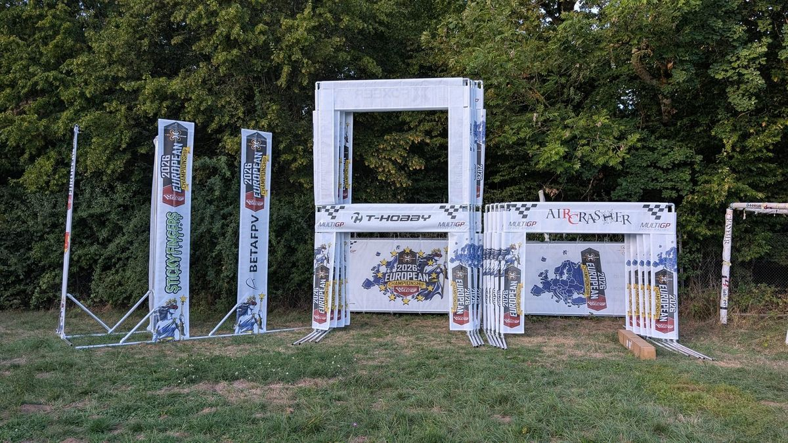

<figcaption>All gates assembled and ready for the track</figcaption>
</figure>

## Result

All 19 obstacles were delivered and installed on schedule and held up through the full three-day championship, including night racing with LED-lit gates. Even in fairly strong wind the gates stayed upright without any guy lines, secured only with simple ground anchors made from bent rebar. Pilots and organisers gave positive feedback in person.

The complete gate set was built by two people in two full working days. The year before, a team of about seven people worked on and off for four days, including nights, to build wooden gates that were thrown away after the event.

| Key figure | Value |
|---|---|
| Pilots / countries | 104 / approx. 21 |
| Obstacles | 4 double gates, 5 single gates, 10 flags |
| Standard tube lengths | 7 |
| Build effort | 2 people, 2 days (previous year: approx. 7 people, 4 days and nights, single-use wooden gates) |
| Guy lines | None needed |
| Ground anchors (bent rebar) | 4 per double gate, 2 per single gate, 1 per flag |
| Material cost | Gates approx. EUR 5,000, fabric approx. EUR 2,500 |

<figure className="proj-fig">

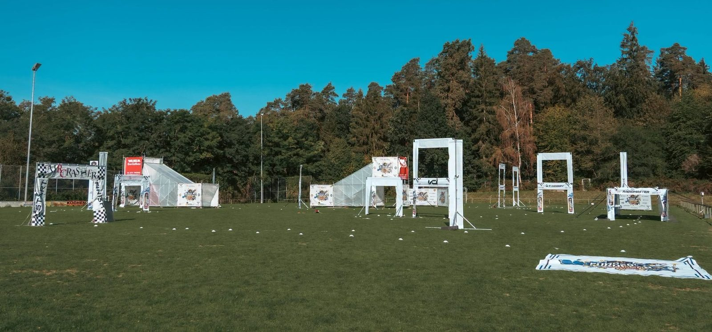

<figcaption>The championship track by day (Photo: MultiGP)</figcaption>
</figure>
<figure className="proj-fig">

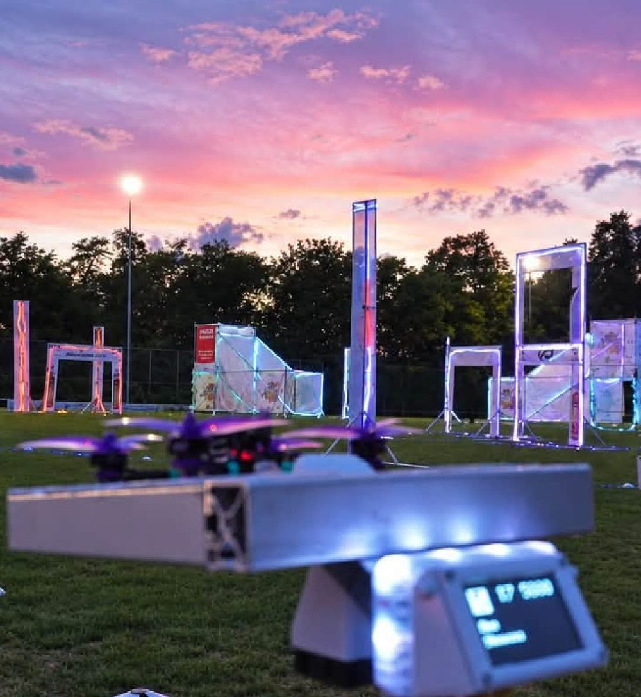

<figcaption>The track at dusk (Photo: RadioMaster)</figcaption>
</figure>

## Conclusion

The modular gate system met all goals: it is stable without guy lines and needs only a few simple rebar anchors, can be assembled by helpers with the build guides, and gives sponsors a clean, professional surface. The project combined mechanical design, technical documentation, supplier management and teamwork under a fixed deadline.

**Lessons learned.** Investing time in planning and CAD up front pays off: standard parts and good documentation cut the build effort from about seven people over four days to two people in two days. Supplier specifications should be checked against a sample before the full order, especially for custom dimensions.

**Outlook.** Unlike the single-use wooden gates of the previous year, the gates are reusable and can be adapted for further events with the same parts and documentation.
