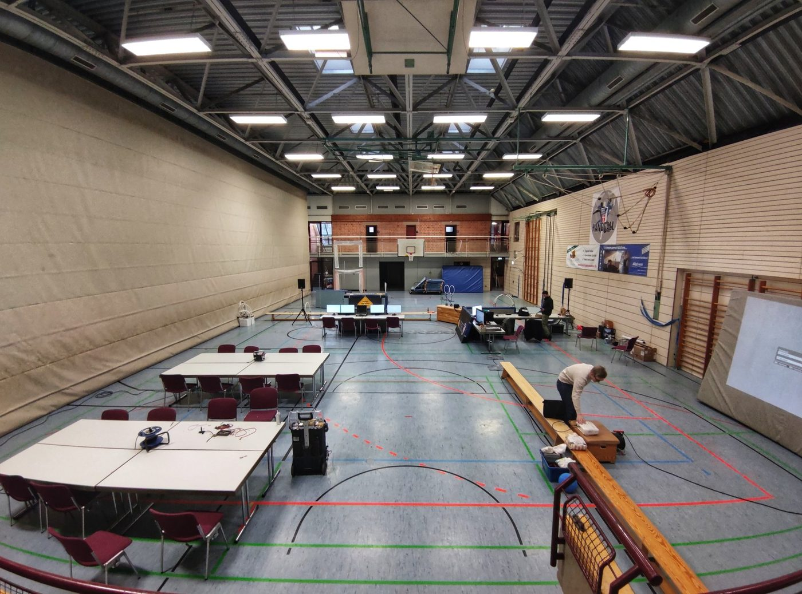
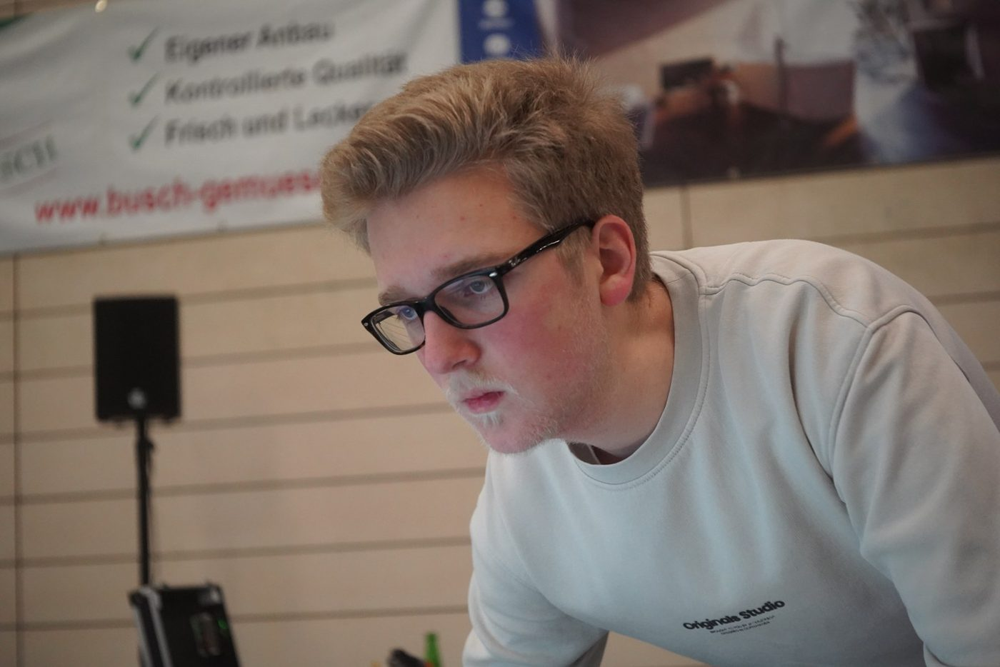

# Race direction and timing

My voluntary work as race director and timing operator at FPV drone races, and the planning of a modular "Eurobox" hardware system for the TSV Korntal drone department.

## Background

At an FPV drone race, the race director runs the whole event: venue setup, timing system, heat schedule, frequencies, track walk, pilot briefing and results. Behind every race day is a mobile technical setup of video receivers, timing hardware, a computer, network and screens that has to be set up and taken down each time.

## My role and scope

Since 2025 I have taken on this role on a voluntary basis, separate from my position as deputy head of the TSV Korntal drone department.

| Event | Number | My role |
|---|---|---|
| Whoop races, TSV Korntal | 3 | Organisation and race direction, 20 to 30 pilots each |
| MultiGP Global Qualifiers, TSV Korntal | 2 | Organisation and race direction |
| FAI and DCS races, Aircrasher chapter | regularly | Race direction or timing, considerably larger fields |

<figure className="proj-fig">

<figcaption>Setting up a sports hall for a race: race control desk, timing, pilot tables and projector screen</figcaption>
</figure>

## Race organisation

### Preparation and setup

For the races at TSV Korntal I handled the organisation from start to finish:

- Setting the date and planning all tasks that had to be done before the race.
- Organising the equipment, such as tables, chairs and the projector.
- Setting up the venue the evening before: deciding where every station stands and how everything is connected.
- Setting up the timing computer and configuring all heats.

### Race day

On race day I led the track walk and the pilot briefing and ran the race schedule. Disputes were settled together as a group decision.

<figure className="proj-fig proj-fig--narrow">

<figcaption>At the race control desk during a race</figcaption>
</figure>

### Timing systems

Lap times are measured from the 5.8 GHz video signal of each drone, so the drones need no extra transponder. At our races we used ImmersionRC LapRF hardware with LiveTime. Besides that, we tested several other software and hardware options:

| System | Type and use |
|---|---|
| LiveTime | Race software used at our races; assigns frequencies automatically |
| RotorHazard, FPVTrackside | Race software, tested |
| NuclearHazard | Timing hardware for RotorHazard, tested |
| ImmersionRC LapRF | Commercial timing hardware used at our races, borrowed from another club |
| ZippyDecoder | Open-source decoder (Raspberry Pi with receiver nodes) for LiveTime, tested |

## Eurobox system

:::info[Status]

Planning largely complete (October 2026). Purchasing and the build of the first boxes are still to come.

:::

### Problem and objective

The club's race hardware is spread over many different cases, and cables are often missing at the venue. I am leading the club's switch to a uniform set of Auer Euroboxes. Every box is a pre-wired, plug-in module that can be set up in under two minutes. The system must replace all functions of the old cases and add new ones: live video, video wall, network and streaming, timing and RF monitoring.

### System architecture

| Box | Contents | Connection | Status |
|---|---|---|---|
| EventVRX box A | HDZero EventVRX 4-channel receiver and capture | USB 3 to laptop | active |
| EventVRX box B | HDZero EventVRX 4-channel receiver and capture | USB 3 to laptop | active |
| Video wall box | 2×2 controller for 4 monitors | HDMI from laptop | active |
| Network box | LTE router and PoE+ switch | LAN to laptop, timer and SDR | active |
| Laptop / OBS box | Race control and streaming | – | on hold |
| Timer box | NuclearHazard timer, powered over PoE | PoE+ | on hold |
| HackRF box | Web SDR for 5.8 GHz band monitoring | LAN | on hold |

Mains power (230 V) is daisy-chained from box to box (C14 in, C13 out, max. 10 A). Each box contains a Mean Well 12 V power supply with a fused output for every device. The two EventVRX boxes have forced ventilation with dust filters, and the receivers' antenna connectors go straight through the box wall.

### Standards, safety and budget

- **Common standards:** connectors only on the sides, real panel-mount sockets instead of loose couplers, 3D-printed handles, mounts and connector plates.
- **Cables:** every box carries its own cables; a five-colour code with matching rings at both cable ends shows which cable belongs to which box.
- **Electrical safety:** 230 V internal wiring with protective earth, fused 12 V distribution, printed touch guards, inspection by a qualified electrician planned.
- **Budget:** target approx. EUR 800. The active scope (two EventVRX boxes, video wall, network, cables, labelling) comes to approx. EUR 695–715. Re-sourcing the panel-mount connectors cut their cost from approx. EUR 96 to EUR 72. Laptop, HackRF and timer boxes (approx. EUR 450–530) were deliberately put on hold to stay within budget.

The planning is documented with layout plans, parts and cable lists, signal and power diagrams and cost breakdowns.

## Result

Feedback from pilots on the races has always been very positive. At our last MultiGP Global Qualifier, held early in the season, the four fastest times worldwide were briefly set at our event, and one time from our qualifier finished in the global top 10.

| Key figure | Value |
|---|---|
| Races directed at TSV Korntal | 5 (3 Whoop races, 2 MultiGP Global Qualifiers) |
| Pilots per Whoop race | 20–30 |
| Timing at races | ImmersionRC LapRF with LiveTime |
| Eurobox budget (active scope) | approx. EUR 700 of EUR 800 |

## Conclusion

Running races combines organisation, technology and communication: the event only works if the schedule, the timing system and the people on site work together. Testing several timing systems showed how much a reliable hardware base that is quick to set up matters on race day.

**Outlook.** The Eurobox system turns this experience into a standard setup. Once the first boxes are built, setup time at every race will drop and missing cables will no longer be an issue.
