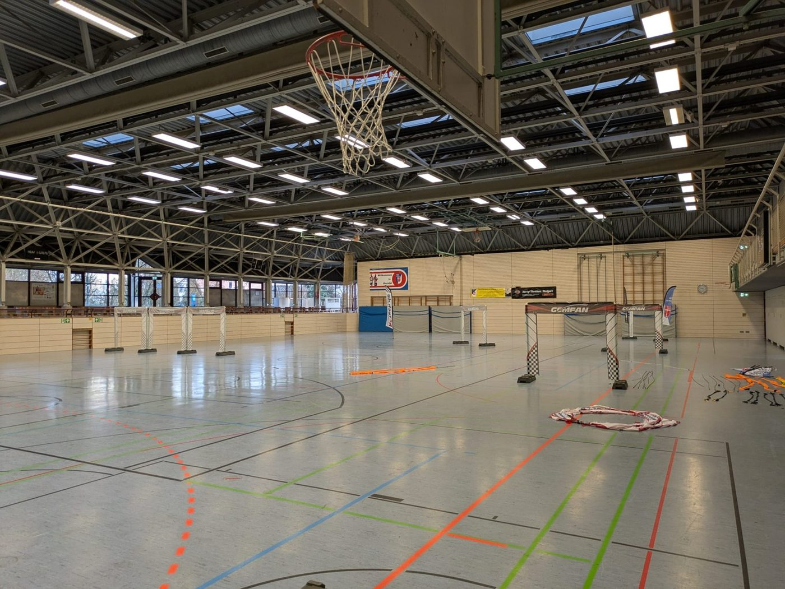
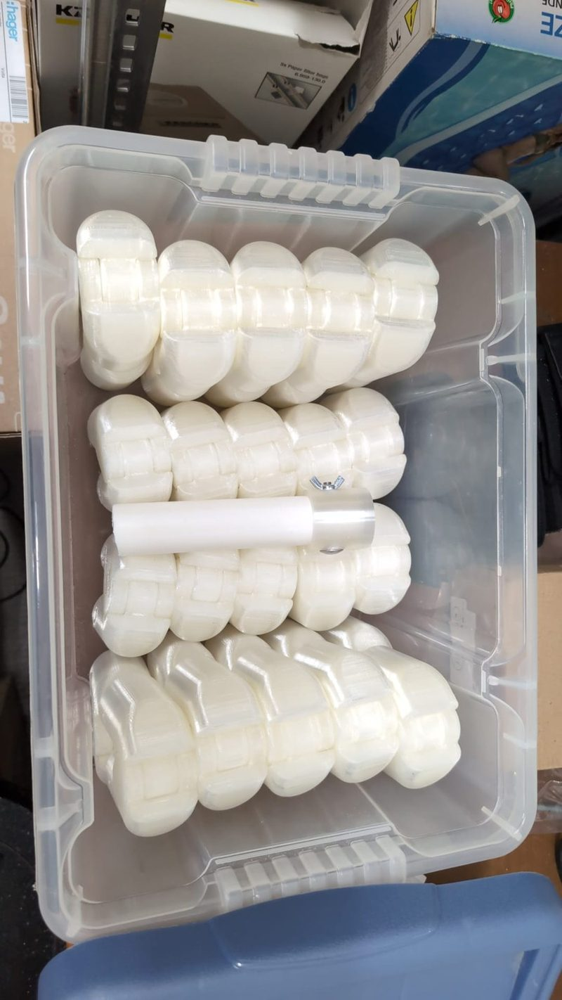
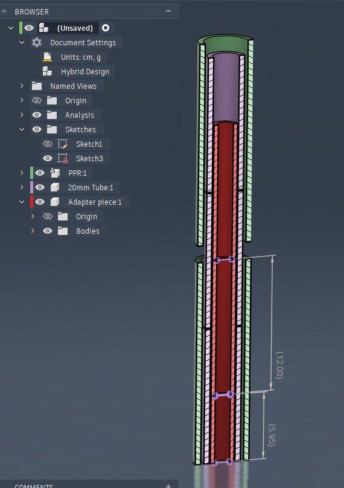
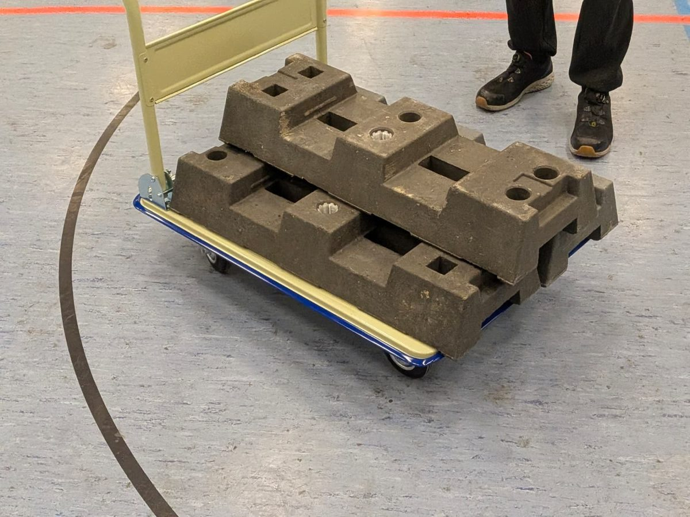
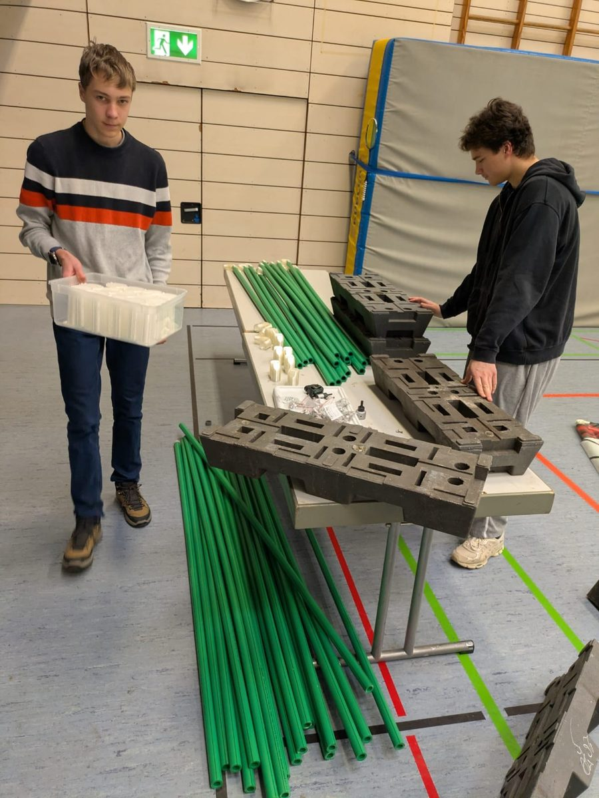
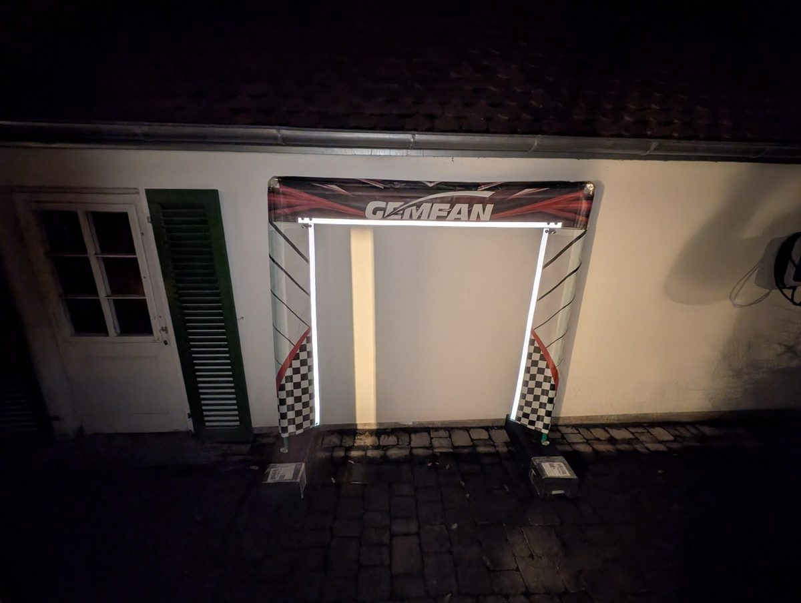

# Crash-resistant race gates for TSV Korntal

Concept, material selection, purchasing and build of a new set of 15 crash-resistant race gates to MultiGP standard for the TSV Korntal drone department (mid to late 2025).

<figure className="proj-fig">

<figcaption>The new gates set up in the sports hall</figcaption>
</figure>

## Background

The TSV Korntal drone department trains and races in a sports hall with 5-inch racing drones. The club's old pop-up gates had worn out so badly that drones got caught in them on almost every flight, and they were no longer usable.

## Objective

A new set of gates in the official MultiGP size (5 × 5 ft opening) that can be stacked into double gates, survives crashes at high speed without breaking, stands securely on the hall floor and is easy to transport and store.

## My role

I was responsible for the overall concept, the purchasing, the production of the printed parts, the organisation of the build and the build guide. I developed the concept and the CAD model together with a fellow club member. I was ill on the day of the build, so I guided the team remotely.

## Material selection

Most DIY race gates worldwide are built from PVC pipe. PVC is cheap, but it splinters when a drone hits it. Our goal was gates where the pipes and connectors are never the parts that break. After a long product and material comparison we chose 32 mm PPR pipe (polypropylene random copolymer), which is normally used for water installations. PPR is flexible and absorbs impacts, but at 32 mm diameter it is still stiff enough for gates over 1.5 m high.

The corners are flexible hinges printed in TPU, based on an open-source design. They give way on impact instead of cracking, and the gate springs back into shape.

For double gates, PPR alone is not stiff enough to keep almost 4 m of stacked pipe straight. We therefore designed a stiffening insert: 20 mm steel tubes are pushed into the posts of the lower gate, with an adapter piece centring them in the PPR pipe, so the upper gate stands straight.

<figure className="proj-fig">

<figcaption>3D-printed TPU corner hinges</figcaption>
</figure>
<figure className="proj-fig">

<figcaption>CAD section of the stiffening insert: 20 mm steel tube with adapter inside the PPR pipe</figcaption>
</figure>

## Components and cost

I compared suppliers for every part and kept a cost sheet with links, unit prices and quantities. Through my pilot sponsorship with Gemfan we got a 32% discount on the gate fabric, which reviews rate among the most durable on the market.

| Component | Per gate | Total (15 gates) |
|---|---|---|
| PPR pipe 32 mm × 2 m | 3 | 45 |
| Gemfan gate fabric | 1 | 15 |
| TPU hinges and adapters (3D-printed) | | approx. 65 parts, approx. 9 kg TPU |
| M6 carriage bolts and wing nuts | 4 each | 60 each |
| Metal snap hooks (top to side fabric) | 4 | 60 |
| Construction fence feet | 2 | 30 |
| Storage strap | 1 | 15 |

## Stable bases

Stability was a major issue: in the hall the gates must not move when a drone hits them at around 150 km/h. After comparing furniture feet with wooden base plates and other options, we chose standard construction fence feet. At approx. EUR 11.50 each from a DIY store they are very cheap, heavy enough to hold the gates in place, and made to be carried. A trolley moves them in and out of storage.

## Production and build

I printed all TPU parts on my own 3D printer. With about 9 kg of filament this was a large amount of work; a swap plate system on the printer made it possible to print batches back to back with little supervision. The club then assembled the gates in the sports hall using my build guide while I gave instructions remotely.

<figure className="proj-fig">

<figcaption>Construction fence feet on the transport trolley</figcaption>
</figure>
<figure className="proj-fig">

<figcaption>Pipes, printed parts and bases ready for assembly</figcaption>
</figure>

## Result

The club now has 15 stackable gates to MultiGP standard that withstand crashes without broken pipes or connectors. The total cost was approx. EUR 1,300. A bonus of the Gemfan fabric is a reflective strip on the inside: it reflects the drones' LEDs, so the gates appear to light up without any electronics on the gate.

<figure className="proj-fig proj-fig--narrow">

<figcaption>The reflective strip lighting up in the dark</figcaption>
</figure>

| Key figure | Value |
|---|---|
| Gates | 15, stackable |
| Gate opening | 5 × 5 ft (MultiGP) |
| Printed parts | approx. 65, 9 kg TPU |
| Fabric discount | 32% via sponsor |
| Total cost | approx. EUR 1,300 |

## Conclusion

Choosing the right material mattered more than any single design detail: switching from PVC to PPR and flexible TPU hinges turned a consumable into equipment that lasts. A detailed cost sheet and a clear build guide made it possible to stay on budget and to build the gates even without me on site.
