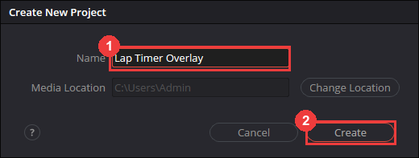
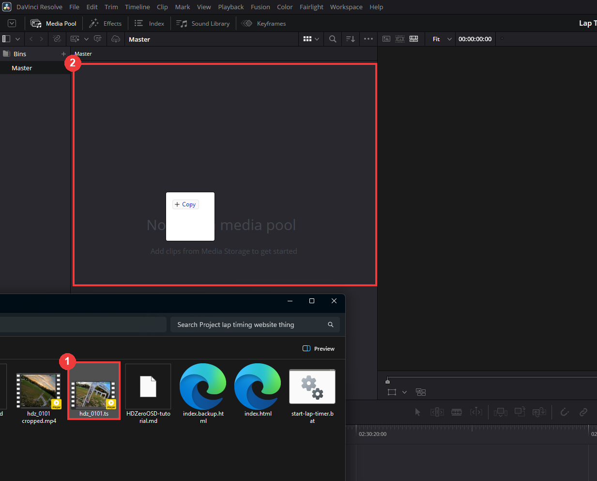
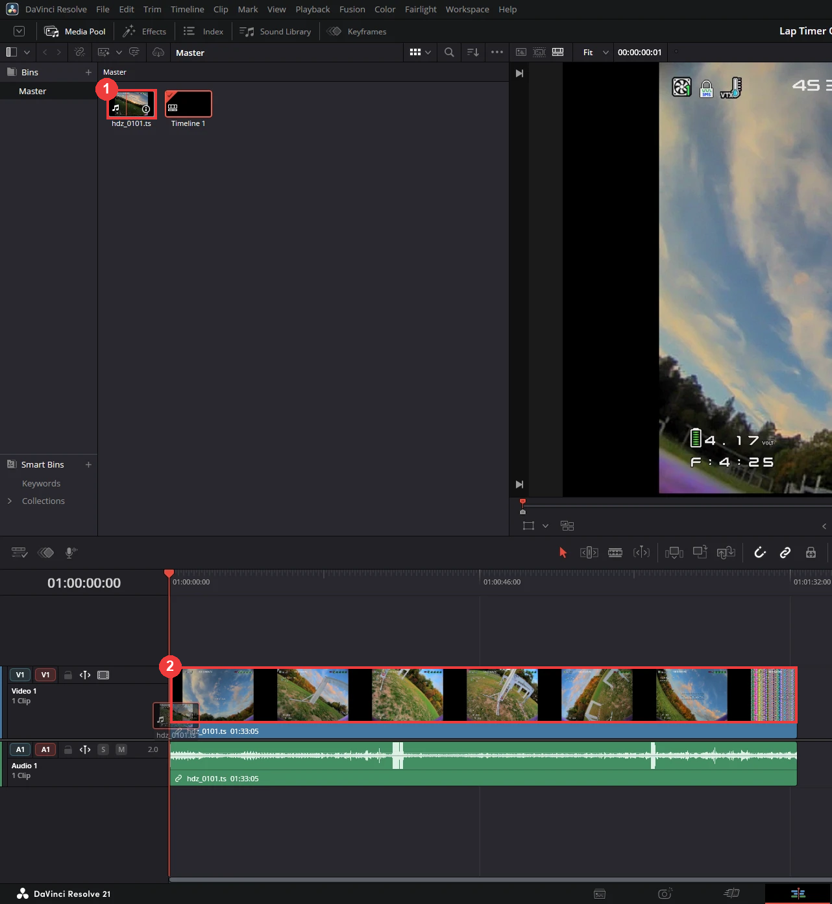
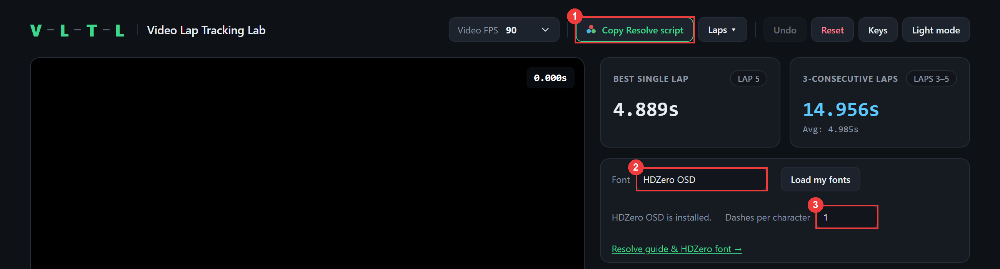
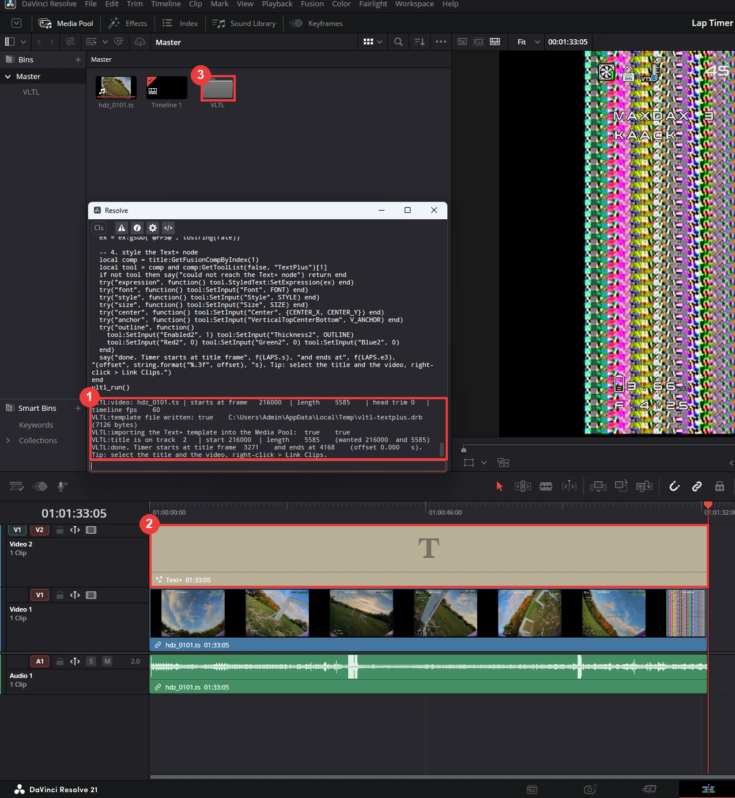
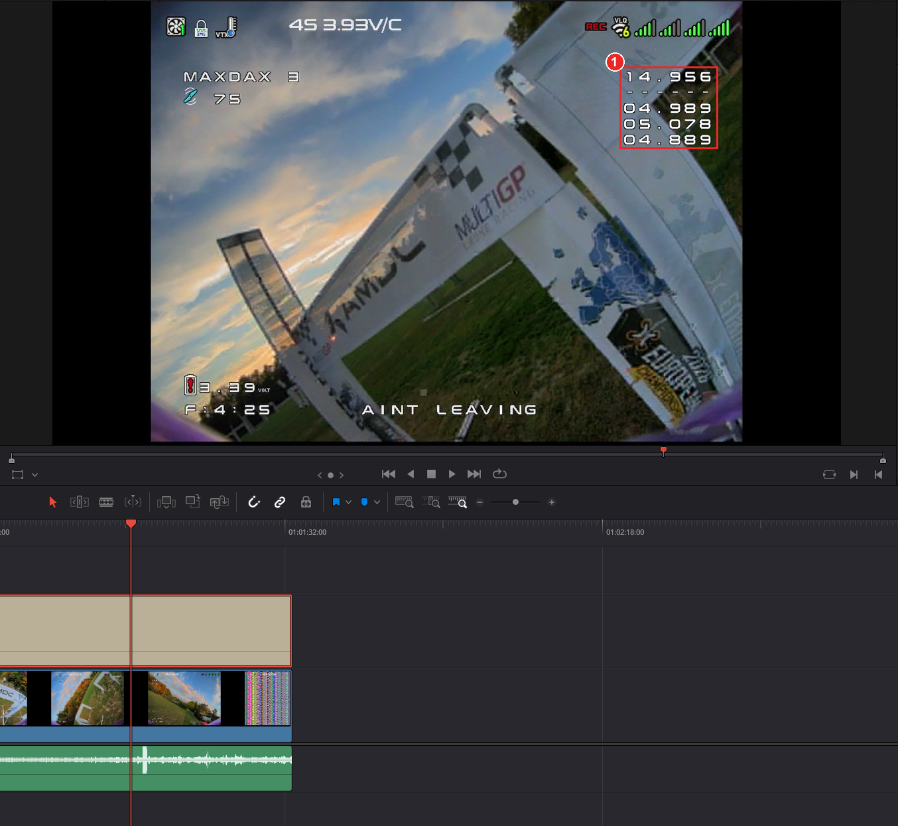

<head>
  <link rel="stylesheet" href="/css/osd-fonts.css" />
</head>

# Lap timer overlay for DaVinci Resolve

Put live lap times on your HDZero footage. You mark your laps in the [lap timer](pathname:///vltl/), copy one script, and paste it into Resolve. It works in the free version of DaVinci Resolve.

## 1. Install the HDZero OSD font {/* #font */}

Do this first, so the font is in Resolve's list later. The goggle OSD is drawn from a bitmap, not a normal font, so Resolve has nothing like it. This font is that bitmap converted to a real `.ttf`: wide, rounded-square letters and **digits that are all the same width**, so the numbers do not jitter as they count.

  
{'F:4:25\n4S 3.93V\nMAXDAX 3\n0123456789'}

  
Live preview: this text is set in the font itself.

  <a className="button button--primary margin-right--sm" href="pathname:///vltl/resolve/HDZeroOSD.ttf" download>↓ Download HDZeroOSD.ttf</a>
  <a className="button button--secondary button--outline" href="pathname:///vltl/resolve/HDZeroOSD-LICENSE.txt">License (MIT)</a>

### Install

1. Download the file with the button above.
2. **Windows:** right-click the file → **Install for all users**.
3. **Mac:** double-click the file → **Install Font**.
4. If DaVinci Resolve is open, **close it and start it again**. Resolve only reads the font list at start.
5. That is all. The script in step 3 picks the font **HDZero OSD** by itself.

### What is in it

Digits, capital letters A–Z (lowercase shows as capitals, like the OSD), and `. : - + / % & ( ) ! ? , ; = < > @ [ ] \ ^ _ #`. No arrows or battery symbols. It is a pixel font: scaled up a lot it looks blocky, like the OSD itself. It has no black edge, which is why the script adds a black outline.

<small className="site-muted">The shapes come from the HDZero goggle firmware font `BTFL_000.bmp` ([hd-zero/hdzero-goggle](https://github.com/hd-zero/hdzero-goggle), MIT license). This is an unofficial conversion, not made or endorsed by HDZero.</small>

### Flying analog? The Betaflight OSD font {/* #analogfont */}

The same idea for analog footage: Betaflight's default analog OSD font (MAX7456) as a `.ttf`. Install it the same way, then pick **Betaflight OSD** at the top of the Font list in the lap timer's **Resolve settings**.

  
{'F:4:25\n4S 3.93V\nMAXDAX 3\n0123456789'}

  
Live preview in the Betaflight OSD font.

  <a className="button button--primary margin-right--sm" href="pathname:///vltl/resolve/BetaflightOSD.ttf" download>↓ Download BetaflightOSD.ttf</a>
  <a className="button button--secondary button--outline" href="pathname:///vltl/resolve/BetaflightOSD-LICENSE.txt">License (GPL-3.0)</a>

<small className="site-muted">Converted from `default.mcm` in [betaflight/betaflight-configurator](https://github.com/betaflight/betaflight-configurator) (GPL-3.0). Capitals, digits and the usual punctuation; no symbols. Unofficial, not made or endorsed by Betaflight.</small>

## 2. Project and video {/* #start */}

### 2.1 Create a project

1. Start Resolve, double-click **New Project** and type a name, for example `Lap Timer Overlay`.
2. Click **Create**.

### 2.2 Add your video to the Media Pool

1. Drag your video file from its folder.
2. Drop it into the **Media Pool**.

### 2.3 Put your video on the timeline

1. On the **Edit** page the clip now sits in the Media Pool. Drag it from there...
2. ...into the empty timeline. Resolve creates the timeline for you, and your video is on track **Video 1**.

:::note
HDZero `.ts` files import fine. If Resolve cannot read yours, convert it to MP4 first with the [ts2mp4 converter](https://github.com/ZeroTasteGuy/ts2mp4) (ffmpeg scripts for converting, upscaling and cropping `.ts` files).
:::

:::note
Any frame rate works; the script reads it from your timeline. The timer is added on Video 2, above your video.
:::

## 3. Copy the script and run it {/* #script */}

### 3.1 Copy it from the lap timer

First mark your laps in the [lap timer](pathname:///vltl/) until it shows your best 3 consecutive laps, with the same video file that is in Resolve.

1. Click **Copy Resolve script**. The script now holds your best 3 laps.
2. **Font**: the page uses **HDZero OSD** when it is installed on your computer (step 1). If it is not, it starts with Open Sans. You can type any font name or pick one from the list. **Load my fonts** lists the fonts installed on this computer (Chrome and Edge ask once for permission). The font must be installed on the computer that runs Resolve.
3. Optional: **Dashes per character** is the length of the dashed line under the total. `1` fits the HDZero OSD font, about `1.5` fits normal fonts. It changes to 1 or 1.5 when you change the font, and you can set it by hand.

### 3.2 Paste it into Resolve's console

1. In Resolve, open your project and make sure the timeline with your video on Video 1 is open (Edit page).
2. Press <kbd>F6</kbd> (or open the menu **Workspace → Console**). A small console window opens.
3. Click into the line at the bottom of the console, press <kbd>Ctrl</kbd>+<kbd>V</kbd> and then <kbd>Enter</kbd>. (If the console has a language button, choose **Lua**.)
4. The console prints lines that start with `VLTL:`. The last one says **done**. The timer is now on Video 2 above your video.

### 3.3 Check the result

1. The console prints lines that start with `VLTL:`. The last one says **done**.
2. The timer is on **Video 2**, over the whole video.
3. The very first time, the script also adds a small Text+ template to your Media Pool (a bin called **VLTL**). You do not need to touch it.

:::note
If the video FPS and the timeline FPS do not divide evenly (for example a 90 fps video on a 60 fps timeline), the timers start and stop on the nearest timeline frame, a few milliseconds off. The frozen lap times shown at the end are still exact.
:::

### 3.4 What the script does for you

- Reads your timeline frame rate and finds your video on Video 1 (by file name, or the clip under the playhead).
- Adds the timer on Video 2 with the same start and length as your video. It also works if the start of the clip is trimmed.
- Sets the font you chose, the size, the position in the top right, and a black outline.
- Fills in the timer so it counts the best 3 laps live and freezes each lap at its exact time.

The look it sets (if you want to change it afterwards)

You can change any of these in the Inspector: click the timer on Video 2, then the **Title** tab.

| Where | Setting | Value |
| --- | --- | --- |
| Text tab | Font | the font you chose on the page (HDZero OSD, Regular by default) |
| Text tab | Size | 0.025 |
| Text tab | V Anchor | -1 (top: the lines grow downwards and the first line stays put) |
| Layout tab | Center X / Y | 0.78 / 0.844 |
| Shading tab, element 2 | Enabled, outline, black | Thickness 0.06 |

Using another resolution or aspect ratio? Change only **Size** until the digits are as tall as the OSD digits, then adjust **Center X/Y**. If you change Size, scale the outline **Thickness** by the same factor.

## 4. Result {/* #result */}

Back on the Edit page, move the playhead over your best 3 laps. The counters count up live, freeze when each lap ends, and show the 3-lap total on top.

1. Total of the 3 laps, a dashed line, then lap 1, lap 2 and lap 3 (frozen at their exact times).

This is how it looks with 1 dash per character:

  
{'14.956\n------\n04.989\n05.078\n04.889'}

  
With the HDZero OSD font and a black outline.

## 5. Trim and edit your video {/* #edit */}

When the timer looks right, you can cut and trim as much as you like. **Link the video and the timer first**, so they stay lined up (the timers count from the start of the timer clip).

1. In the timeline, select the timer clip on Video 2 and your video clip.
2. Right-click one of them → **Link Clips** (shortcut <kbd>Ctrl</kbd>+<kbd>Alt</kbd>+<kbd>L</kbd>). A tick next to it means they are linked.
3. Now trim, cut and move the clips as much as you want. The video and the timer move together, so the timers stay in step with the video.

:::warning
If you trim the video or the timer on its own (not linked) after the script ran, the timers no longer match the video. To redo it, delete the timer clip on Video 2 and run the script again.
:::

## If something looks wrong {/* #trouble */}

- **The console shows an error, or nothing happens:** open your project and the timeline first, then paste again. Check that you copied the whole script.
- **"Could not tell which clip on Video 1 is your video":** your video must be on Video 1. Put the playhead on it and run the script again. It also helps when the video in the lap timer has the same file name as the clip in Resolve.
- **"Could not add the template":** add it by hand once. On the Edit page open **Effects → Titles**, drag **Text+** into the Media Pool, rename it `VLTL_TextPlus`, and run the script again.
- **The font looks wrong or is missing:** the font has to be installed on the computer that runs Resolve. For HDZero OSD, install it as in step 1 and restart Resolve. Resolve only reads its font list at start. If you typed a font name, check the spelling.
- **I ran it twice and now there are two timers:** every run adds a new title on Video 2. Delete the extra one.
- **The timers start at the wrong moment:** the marks come from the video loaded in the lap timer. Make sure it is the same file as in Resolve, check the lap marks, then copy and run the script again (after deleting the old timer).
- **The dashed line is too long or too short:** change **Dashes per character** in the lap timer, copy the script again, and delete the old timer first.

---

<small className="site-muted">Part of [Video Lap Tracking Lab](pathname:///vltl/). Everything stays in your browser; no video is uploaded. Screenshots are from DaVinci Resolve 21; other versions look a little different.</small>
